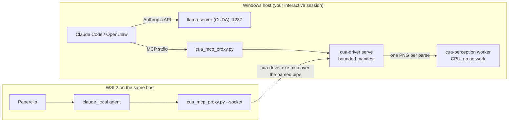

# Cua Perception: evaluation and rollout for this stack

**Verdict: yes, with limits.** Cua Perception adds real value to this stack in two places:

1. **It gives your local GGUF models usable eyes.** It turns a screenshot into text and icon
   regions with pixel bounds. A text-only model served by llama-server (no `--mmproj`) can
   then find and click on-screen targets. It runs on the CPU with zero VRAM, so it doesn't
   compete with the model already filling your GPU.
2. **It covers surfaces with no accessibility tree.** Canvas and custom-drawn apps, games,
   remote-desktop windows, and some Electron and web views fall into this group.

It is **not** a standalone tool. It is an optional add-on to **Cua Driver**, and Cua Driver
is the bigger win: a local MCP server that lets Claude Code, OpenClaw and Paperclip agents
operate Windows GUI apps. Desktop Commander only covers the shell and files.

Adopt it in this order:

1. Cua Driver.
2. Perception as a fallback.
3. Bounded, unattended use from Paperclip.

Avoid Perception on the primary path, for browser work, and in anything other people use
over a network (the AGPL clause below).

## What Cua Perception is

| | |
|---|---|
| What it adds | One MCP tool, `parse_visual_regions`. It parses one retained screenshot into `text` and `icon` regions (`[x,y,w,h]`, confidence, OCR text) |
| Models | OmniParser v2 icon detector (**AGPL-3.0-only**), PP-OCRv5 mobile detector + **English** recognizer (Apache-2.0) |
| Runtime | ONNX Runtime 1.26 **CPU only**. Two intra-op threads, fixed by the signed manifest. No GPU, no Python, no network |
| Safety model | The worker has no capture, input or network authority. Every click derived from a parse is bound to that capture: one use, 60 s lifetime |
| Distribution | Signed per-platform catalog + archive per `cua-perception-v*` release: Windows x64, Linux x64, macOS arm64. Never auto-installed. Hot install and remove, no restart |
| Size | Windows archive 421 MB; Linux installs to 458 MB |
| Maturity | 0.2.0 on 2026-09-23, 0.2.1 on 2026-09-26. The GA criteria issue ([#4189](https://github.com/trycua/cua/issues/4189)) is still open. Cua Driver 0.28.3, which introduced it, was **withdrawn**. Use Driver 0.30.x |

## Your stack (as I inferred it)

I built this picture from your `llama-server-manager` skill and this repository. Correct me
where it's wrong; each section says what depends on these facts.

- **Windows host with NVIDIA CUDA.** llama-server runs on port 1237, bound to `0.0.0.0` for
  LAN and Tailscale. It serves a ~15 GB GGUF with 131k context and a q4_0 KV cache on a
  16 GB GPU. Models live in LM Studio's folder.
- **Agents:** OpenClaw/NemoClaw, plus the Claude desktop app with Desktop Commander.
- **Paperclip** (this repo is its test project). Paperclip runs only on macOS, Linux or WSL2,
  **not natively on Windows** (`scripts/install.sh` refuses other OSes).

## Fit analysis

| Use case | Perception helps? | Why |
|---|---|---|
| Local text-only model driving Windows apps | **Strongly** | Without it the model gets images it can't read. llama-server rejects image input with no mmproj: `image input is not supported` |
| Local vision model (has `--mmproj`) | Moderately | Region text and bounds are more precise and cheaper than screenshot tokens, and the mmproj adds VRAM you don't have spare |
| Canvas apps, games, RDP/VNC windows, custom-drawn UIs | **Yes** | These are the surfaces with no accessibility targets |
| Standard Win32/WPF/WinUI/Electron apps | Rarely | The UIA tree is faster (~0.5 s capture) and exact. Use `element_index` first |
| Browser work | No | Cua's typed browser tools act on the DOM with origin checks. Use those |
| Cloud Claude sessions | Marginal | Claude reads screenshots well. Perception mostly saves tokens and adds capture binding |
| Anything reading numbers to act irreversibly | Only with verification | OCR dropped digits in testing (below) |

## What I measured

I ran the real release in a Linux x64 container: 4 vCPU, Xvfb + openbox, Chromium, Cua Driver
0.30.3, Perception 0.2.1. The test page was painted entirely on a `<canvas>`, so Driver's
accessibility walk found only the window. That is the case Perception exists for.

| Check | Result |
|---|---|
| Release integrity | `SHA256SUMS` matched. `extension inspect`: `publisher-verified`, ed25519 key `cua-extension-ed25519-2026-09`. Catalog expires **2027-09-26** |
| Install + self-test | 12 s install; `status --self-test` healthy |
| Parse latency, 1100×720 window, 12 regions | First parse 4.2–5.2 s (cold worker), then **2.4–3.0 s** |
| Parse latency, 2500×1400 dense window, ~400 regions | 6.7–9.8 s. Time grows with the amount of text on screen |
| Upstream numbers (Cua's harness) | macOS 2–2.5 s, Linux 3.5–4 s, **Windows 8–9 s** per parse. Plan on Windows being ~2× the Linux numbers |
| `kinds` / `max_regions` | Trim output only. Both models always run, so compute is unchanged |
| OCR accuracy, 384 labels at 15 px | 97.7% exact at native resolution, 96.1% at Driver's default downscale. Misreads included dropped digits (`Shipping 110` for `Shipping 1101`) |
| Downscaled capture | 326 icon regions vs 47 at native, on a page with no icons. Pass `max_image_dimension: 0` when you parse |
| Capture-bound click on canvas | Found `Submit Order`, clicked it, title changed. Replaying the capture: `capture_not_found`. After 62 s: `capture_expired` |
| Background click into Chromium (X11) | Refused, `background_unavailable`. Foreground worked. No silent fallback |
| Bounded mode | Manifest valid. `get_desktop_state` denied. **`list_windows`/`list_apps` refused unless scoped to a manifest app's `pid`** |
| Tool-schema context cost | All 62 tools ≈ 45k tokens; a 12-tool set ≈ 15k; the 7-tool visual set ≈ 10k |
| What the model sees | Driver puts `capture_id` and regions **only in `structuredContent`**. The text block says only `Parsed N visual regions`. `cua_mcp_proxy.py --inline-structured` fixes this for any client |

Reproduce any of this with `tools/perception_smoke.py` (below).

## Recommended architecture



- **One daemon per interactive session**, started by Cua's `cua-driver-serve` Scheduled Task
  (`LogonType: Interactive`). SSH and WSL callers reach it through `\\.\pipe\cua-driver`,
  because SSH shells run in Session 0 and can't see any windows.
- **Two permission layers, and both must allow an action:** the MCP client's approvals and
  Cua's permission mode. Paperclip's `claude_local` skips client approvals by default
  (`dangerouslySkipPermissions: true`). That makes a **bounded manifest mandatory** for
  Paperclip agents.
- Perception stays a **fallback rung**: accessibility tree → browser refs → visual regions.

## Phase 1: install on the Windows host (now)

From a console or RDP session, in a normal (non-elevated) PowerShell, from this repo:

```powershell
powershell -NoProfile -ExecutionPolicy Bypass -File integrations\cua\windows\Install-CuaStack.ps1
```

The script:

- pins Cua Driver 0.30.3 and Perception 0.2.1;
- sets telemetry off *before* the first run (so no installation ID is ever created — verified);
- verifies the Driver zip against the release's `checksums.txt`, then proves the installed
  `cua-driver.exe` is byte-identical to it (the official installer checks no hashes);
- verifies the Perception catalog and archive against `SHA256SUMS`;
- shows the signed `extension inspect` output, licenses included, and asks before installing.

Then register the clients (open a new terminal first):

```powershell
claude mcp add --transport stdio cua-driver -- cua-driver mcp   # Claude Code with cloud Claude
cua-driver mcp-config --client openclaw                          # prints the OpenClaw command; run it
python integrations\cua\tools\perception_smoke.py --window-title "<a window title>" --runs 3
```

### Local model through llama-server

Add these to the llama-server batch file your skill already uses:

- `--jinja` (required for tool calls)
- `--alias local-cua`
- `--api-key <secret>`, because you bind `0.0.0.0`: anyone on the LAN or tailnet can
  otherwise use the model
- `--mmproj <file>` only if the model has a vision projector *and* VRAM allows it.
  Otherwise stay text-only; Perception is built for that case.

Then:

```bat
set LLAMA_API_KEY=<secret>
integrations\cua\windows\start-claude-local-cua.cmd
```

The launcher follows Cua's tested local-model recipe (`--bare --strict-mcp-config --tools ""`)
and adds four things:

- the proxy with the 7-tool visual set (~10k schema tokens instead of ~45k);
- screenshot stripping, for text-only models;
- inline `capture_id` and regions;
- `min_confidence 0.5` by default, plus the short rules in `mcp/local-agent-instructions.md`.

A 131k context minus ~10k of schemas leaves room. Keep `get_window_state` bounded
(`max_elements`, `max_depth`), as the instructions say.

## Phase 2: unattended Paperclip agents (next)

1. **Scope what agents may touch.** Copy `windows/cua-capabilities.yaml` and edit the app and
   folder entries. Use real executable paths from `(Get-Process <name>).Path`; Windows 11's
   `notepad.exe` and `calc.exe` are Store launcher stubs. Then:
   ```powershell
   powershell -NoProfile -ExecutionPolicy Bypass -File integrations\cua\windows\Install-CuaStack.ps1 -SkipDriver -SkipPerception -PinBoundedMode
   ```
   A bounded daemon with a bad manifest refuses to start rather than falling back to
   `standard`. Test all three cases: allowed, other app (`bounded_resource_outside_manifest`),
   unlisted tool (`permission_denied`).
2. **Run Paperclip in WSL2 on the same box.** Use `paperclip/claude-local-agent.adapter.json`
   as the agent's adapter config:
   - `engine: "cli"` is required; the default ACP engine ignores `extraArgs`.
   - `paperclip/cua-mcp.wsl.json` calls `cua-driver.exe` through WSL interop with
     `--socket \\.\pipe\cua-driver`.
   - Verify it from WSL with
     `python3 integrations/cua/tools/perception_smoke.py --driver cua-driver.exe --socket '\\.\pipe\cua-driver' --pid <pid>`.
3. **Browser tasks need their own runtime** with an origin-scoped manifest. Cua refuses
   generic input tools in a manifest that lists browser origins. Otherwise a desktop runtime
   that can click the browser makes the origin list meaningless.
4. **Don't mix MCP sources on one agent.** When Paperclip's own MCP gateway assigns servers,
   it adds its own `--mcp-config ... --strict-mcp-config`. Whether Claude Code merges that
   with `extraArgs` is unverified.

## Phase 3: later

- **GPU inference for Perception.** Today it is CPU-only with thread count locked by the
  signature. A DirectML/CUDA build would take parses from seconds to well under one; watch
  `cua-perception-v*` releases. Until then, Windows at ~8 s per parse fits supervised or
  low-step tasks, not long loops.
- **Local chooser models.** Cua's CUA-S1 models (starting with forms) are small System-1
  decision models. Served on your GPU, one could pick among regions the way the paid
  `jev-use`/TypeSafe chooser does, keeping everything local.
- **Isolation.** For fully unattended runs, point agents at a disposable desktop instead of
  your own: a Windows VM, or a Cua Fleet Linux desktop. Lume is Apple Silicon only.
- **Evaluation.** Cua Bench can score your local model on your own tasks before you trust it.
- **Renewal.** The 0.2.1 catalog expires 2027-09-26. Update with `extension inspect` →
  `extension update` → `status --self-test`.
- **Languages.** The OCR recognizer is English only; wait for a multilingual build before
  using it on non-English UIs.
- **Licensing.** If Paperclip ever serves people outside your own use, the AGPL network
  clause (§13) can require publishing corresponding source. Either remove the extension
  (Driver keeps working; the tool returns `not_installed`) or license the detector
  commercially from Ultralytics.

## Files in this folder

| File | Purpose |
|---|---|
| `windows/Install-CuaStack.ps1` | Pinned, checksum-verified install of Driver + Perception; telemetry off; optional bounded mode |
| `windows/cua-capabilities.yaml` | Bounded manifest template (tool names and schema validated against Driver 0.30.3) |
| `windows/start-claude-local-cua.cmd` | Claude Code → your llama-server + filtered Cua tools |
| `mcp/cua_mcp_proxy.py` | Stdio proxy: tool allowlist, screenshot stripping, inline `capture_id`/regions, parse defaults, `--socket` |
| `mcp/local-model.mcp.json` | MCP config used by the launcher |
| `mcp/local-agent-instructions.md` | ~350-token loop rules for local models |
| `paperclip/cua-mcp.wsl.json` | MCP config for Paperclip agents in WSL2 driving the Windows desktop |
| `paperclip/claude-local-agent.adapter.json` | Example `claude_local` adapter config |
| `tools/perception_smoke.py` | Benchmark and end-to-end check: capture → parse → bound click → replay refusal → reobserve |

Proxy tests: `pytest tests/test_cua_mcp_proxy.py` (fake driver; no Cua install needed).

## Pitfalls checklist

- [ ] Run Driver setup from the console or RDP. Over SSH everything is Session 0 and window lists are empty.
- [ ] Don't pipe `irm … | iex`. The official Windows installer checks no hashes; use the script here.
- [ ] Never install Driver 0.28.3 (withdrawn). Pin versions; Driver ships almost daily.
- [ ] Keep the Perception catalog and archive in the same folder; Driver resolves the archive beside it.
- [ ] In Windows PowerShell 5.1, `$ProgressPreference='SilentlyContinue'` before large downloads, or the 421 MB archive crawls.
- [ ] One persistent MCP session per task. The first parse pays the ~2 s cold start, and `capture_id`s don't survive across processes.
- [ ] Parse native pixels (`max_image_dimension: 0`). Downscaled captures multiply false icon regions.
- [ ] `background_unavailable` is a refusal, not permission to retry in the foreground.
- [ ] Never act on OCR'd numbers or amounts without confirming them from the app's own state.
- [ ] `list_windows` in bounded mode needs a manifest app's `pid`; otherwise use `launch_app` and its returned window.
- [ ] Add `--api-key` to llama-server while it listens on `0.0.0.0`; Claude Code sends it as `X-Api-Key`, which llama-server accepts.
- [ ] Text-only model → keep `--strip-images`, or every turn with a screenshot fails in llama-server.
- [ ] Windows `python` may be the Microsoft Store alias; install python.org Python (or use `py -3`) for the proxy.
- [ ] If llama-server offloads MoE experts to the CPU, leave cores free: Perception uses 2 threads per parse.
- [ ] `cua-driver telemetry disable` does not delete an existing installation ID; `telemetry reset-id` does. Setting telemetry off before install avoids creating one.
- [ ] AGPL: private use is fine; redistribution or network-served use is not free of obligations.

## What I could not verify here

- **Anything Windows-specific at runtime.** The container is Linux. Windows latency figures
  are Cua's, and the PowerShell script was only parse-checked and unit-tested for its hash
  logic, under PowerShell 7.6 on Linux.
- **WSL interop to the Driver's named pipe.** It should work (same Windows account), but run
  the smoke test from WSL before relying on it.
- **Claude Code ↔ llama-server end to end.** This is Cua's tested recipe; I didn't run a model.
- **What Claude Code forwards to the model.** GitHub issues suggest `structuredContent` is
  forwarded, but it isn't documented. The proxy's inline text makes the setup work either way.
- **Your GPU, CPU, model and mmproj.** The recommendations are conditional where these matter.

## Sources

- Cua repo: <https://github.com/trycua/cua>
- Perception docs:
  - [perception-extension.md](https://github.com/trycua/cua/blob/main/libs/cua-driver/docs/perception-extension.md)
  - [third-party notices](https://github.com/trycua/cua/blob/main/libs/cua-driver/docs/perception-third-party-notices.md)
  - [how it works](https://github.com/trycua/cua/blob/main/docs/content/docs/concepts/how-the-perception-extension-works.mdx)
  - [parse-visual-regions guide](https://github.com/trycua/cua/blob/main/docs/content/docs/how-to-guides/driver/parse-visual-regions.mdx)
- Releases and tracking:
  - [cua-perception-v0.2.1](https://github.com/trycua/cua/releases/tag/cua-perception-v0.2.1)
  - [RFC #3931](https://github.com/trycua/cua/issues/3931)
  - [GA criteria #4189](https://github.com/trycua/cua/issues/4189)
- Driver guides:
  - [local models](https://github.com/trycua/cua/blob/main/docs/content/docs/how-to-guides/driver/run-with-local-model.mdx)
  - [bounded manifests](https://github.com/trycua/cua/blob/main/docs/content/docs/how-to-guides/driver/write-a-bounded-manifest.mdx)
  - [Windows over SSH](https://github.com/trycua/cua/blob/main/docs/content/docs/how-to-guides/driver/windows-ssh.mdx)
  - [telemetry](https://github.com/trycua/cua/blob/main/docs/content/docs/reference/cua-driver/telemetry.mdx)
- llama.cpp server: [README](https://github.com/ggml-org/llama.cpp/blob/master/tools/server/README.md) (Anthropic `/v1/messages`, `--api-key`, `--jinja`)
- Paperclip: <https://github.com/paperclipai/paperclip> (`claude_local` adapter, `doc/INSTALLING.md`)
